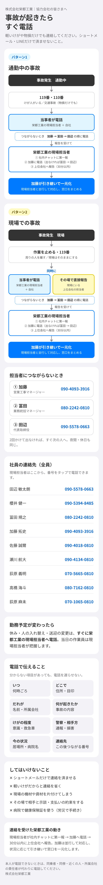

<!doctype html>
<html lang="ja">
<head>
<meta charset="utf-8">
<meta name="viewport" content="width=device-width, initial-scale=1">
<meta name="robots" content="noindex, nofollow">
<title>事故発生時の緊急連絡フロー｜株式会社栄都工業</title>

</head>
<body>
<main>
  

    
株式会社栄都工業｜協力会社の皆さまへ

    <h1>事故発生時の緊急連絡フロー</h1>
    
下の画像をスマホに保存してください。保存すれば、電波がない場所でも写真アプリから見られます。

    <ol>
      <li>下の画像を<b>長押し</b></li>
      <li>iPhoneは「<b>"写真"に保存</b>」、Androidは「<b>画像をダウンロード</b>」</li>
    </ol>
    <a class="btn btn-main" href="flow.jpg" download="緊急連絡フロー_栄都工業.jpg">画像を保存する</a>
  

  

    
<b>緊急連絡先を電話帳に登録</b>

    
加藤・冨田・田辺の3人を、まとめて連絡先に追加できます。開いたら「すべてを追加」または「インポート」を選んでください。

    <a class="btn btn-sub" href="contacts.vcf">連絡先に登録する</a>
  

  
</main>
</body>
